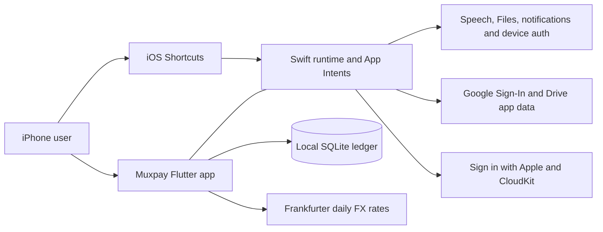
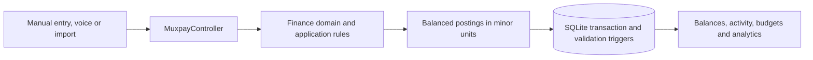
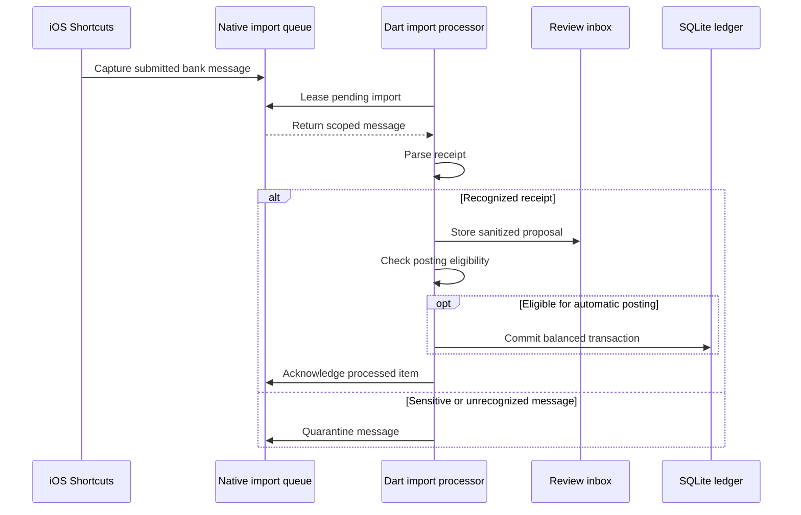
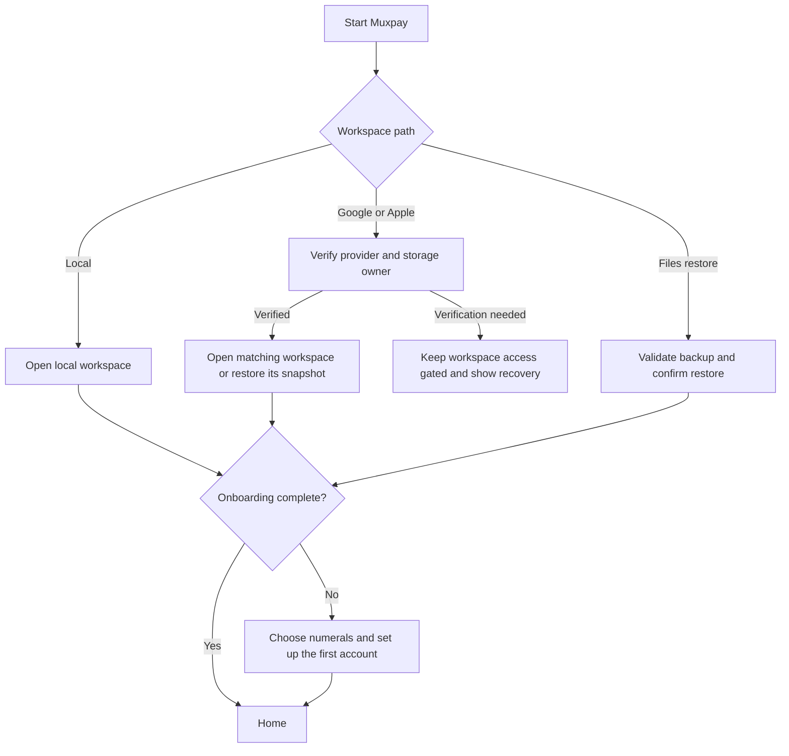
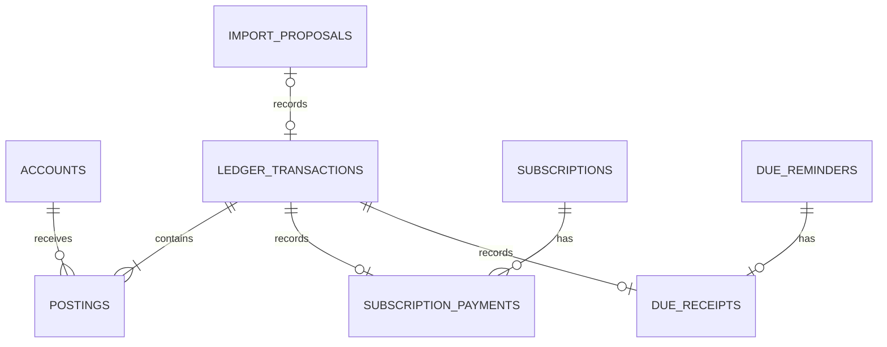

<p align="center">
  
</p>
<h1 align="center">Muxpay — Personal Finance for iPhone</h1>

Muxpay is an **Arabic-first personal finance app** for iPhone users who want to track accounts, spending, and upcoming bills. Its right-to-left Flutter interface brings together a local ledger, budgets, subscriptions, installments, and currency holdings. Users can record activity manually, dictate expenses in Egyptian Arabic, or submit supported bank messages through iOS Shortcuts.

The active ledger lives in SQLite. Swift integrations handle Shortcuts, speech recognition, device authentication, notifications, and Files. Users can start with a local workspace or connect a separate Google or Apple workspace for cloud backup and restore.

---

## Table of contents

- [Elevator pitch](#elevator-pitch-cv--interview)
- [Tech stack at a glance](#tech-stack-at-a-glance)
- [Diagrams](#diagrams)
  - [1. System context](#1-system-context)
  - [2. Ledger write path](#2-ledger-write-path)
  - [3. Bank message intake](#3-bank-message-intake)
  - [4. Workspace startup](#4-workspace-startup)
  - [5. Core data model](#5-core-data-model)
- [Repository layout](#repository-layout)
- [Packages & dependencies](#packages--dependencies)
- [Feature flags & configuration](#feature-flags--configuration)
- [API surface](#api-surface)
- [Testing & quality](#testing--quality)
- [Getting started](#getting-started)
- [Documentation index](#documentation-index)
- [License](#license)

---

## Elevator pitch (CV / interview)

- **Built a double-entry ledger for day-to-day finance.** Store money in integer minor units, require balanced postings in one book currency per transaction, and enforce ledger invariants in SQLite. Model transfers, card repayments, refunds, and reversals explicitly.
- **Turned bank messages into reviewable ledger entries.** Capture Shortcuts submissions in an encrypted native queue. Duplicate checks, account matching, and opening-balance checks determine whether a recognized receipt can post automatically or needs review.
- **Designed Arabic-first capture and planning.** Parse Egyptian Arabic expense dictation and ask for clarification when needed. Apple server speech recognition requires consent. Use ledger activity for budgets, spending analytics, and a read-only purchase simulator.
- **Scoped workspaces to their owners.** Revalidate provider identity at startup, preserve separate local, Google, and Apple ledgers, and reconcile compatible cloud snapshots using a versioned change journal. Validate a candidate before applying it to the active ledger.
- **Grounded Ask Mux in the user's ledger.** Ask Mux combines local product guidance with read-only financial queries. A bundled Dart classifier proposes intent, and scoped calculations run against the ledger.

---

## Tech stack at a glance

| Layer | Technology |
| --- | --- |
| iPhone UI | Flutter, Dart, Material, Cairo font, right-to-left Arabic layout |
| State and navigation | GetX `GetBuilder`, Flutter `Navigator` |
| Ledger and persistence | SQLite through `sqflite`, integer minor units, schema version 24 |
| iOS integration | Swift, Flutter platform channels, App Intents, App Groups, Keychain |
| Device capabilities | Apple Speech, Local Authentication, User Notifications, Files, Core Text |
| Optional account storage | Google Sign-In and Drive app data, Sign in with Apple and CloudKit private database |
| FX reference rates | Frankfurter daily rates |
| Quality | Flutter analyzer, Flutter unit and widget tests, SQLite FFI, Flutter integration tests, SwiftPM, XCTest |
| Companion website | Python 3 static generator, HTML, CSS, JavaScript |

---

## Diagrams

### 1. System context

Flutter owns the active SQLite ledger. Swift exposes iOS features through platform channels and connects optional provider storage. The currency assets module fetches daily FX reference rates.



### 2. Ledger write path

Entry flows share the finance domain's money and posting rules. A committed transaction feeds balance, budget, and analytics views. Corrections can preserve the original record through linked ledger entries.



### 3. Bank message intake

A Shortcuts automation submits the message to Muxpay. The processor checks recognized receipt evidence, duplicate history, account resolution, and the opening-balance boundary before an eligible entry can post.



### 4. Workspace startup

Startup revalidates saved provider identity before resuming its ledger. The workspace's identity scopes local snapshots and cloud backups. Users can also choose the local workspace or import a backup through Files.



### 5. Core data model

Accounts and transactions meet in the postings table. A transaction requires at least two postings. Import proposals, subscription payments, and due receipts associate intake or planning records with the ledger.



---

## Repository layout

```text
muxpay-final/
├── lib/                     # Flutter app, finance and platform adapters
├── ios/                     # Runner, App Intents, Swift package and XCTest
├── assets/                  # Brand, font and tutorial assets
├── test/                    # Flutter unit, widget and SQLite tests
├── integration_test/        # iOS-hosted Flutter scenarios
├── test_driver/             # Integration test drivers
├── docs/                    # Engineering guides and bilingual website
├── data/                    # Voice data and corpus notes
├── experiments/             # Voice model research
├── tool/                    # Checks, benchmarks and model evaluation
└── pubspec.yaml              # Flutter dependencies and bundled assets
```

| Path | Role |
| --- | --- |
| `lib/app/` | App shell, controller, import orchestration, chat and cloud coordination |
| `lib/features/` | Finance, accounts, planning, analytics, imports, voice and onboarding |
| `lib/design_system/` | Shared theme, components and planning visuals |
| `lib/platform/` | Dart adapters for speech, device authentication, the import queue and notifications |
| `ios/` | Swift host and extension, platform bridges, import package and native tests |
| `assets/` | Runtime iconography, Cairo font and setup tutorials |
| `test/` · `integration_test/` | Host-side Flutter tests and iOS-hosted application scenarios |
| `docs/` · `tool/` | Product and integration docs, website generation, verification and model tooling |

### Flutter entry point and finance

```text
lib/
├── main.dart
├── app/
│   ├── muxpay_app.dart
│   ├── muxpay_controller.dart
│   ├── muxpay_chat.dart
│   ├── bank_import_inbox.dart
│   ├── automatic_import_processor.dart
│   └── cloud/
├── features/
│   ├── finance/
│   │   ├── domain/
│   │   ├── application/
│   │   └── infrastructure/
│   │       ├── finance_database.dart
│   │       ├── sqlite_schema.dart
│   │       ├── finance_backup.dart
│   │       └── finance_sync_merge.dart
│   ├── bank_import/
│   ├── import_review/
│   ├── voice_entry/
│   └── cloud_backup/
└── platform/
```

### Native iOS targets

```text
ios/
├── Runner/
│   ├── AppDelegate.swift
│   ├── CloudBackupBridge.swift
│   ├── SpeechCaptureBridge.swift
│   ├── BackupFilesBridge.swift
│   ├── TransactionPdfRenderer.swift
│   └── NativeImport/
│       ├── BackgroundBankMessageIntent.swift
│       └── ImportQueueMethodChannel.swift
├── MuxpayImportIntents/          # Compatibility App Intents extension
├── Packages/
│   └── MuxpayImportCore/         # Secure queue and cloud/session policies
├── RunnerTests/
└── Runner.xcworkspace/
```

---

## Packages & dependencies

### Flutter app

| Package | Role in Muxpay |
| --- | --- |
| `flutter`, `flutter_localizations` | App UI, localized widgets and RTL presentation |
| `get` | Controller-backed UI updates with `GetBuilder` |
| `sqflite`, `path` | SQLite access and database file paths |
| `crypto` | SHA-256 fingerprints and integrity checks for imports, backups and sync |
| `characters` | Grapheme-aware category input |
| `url_launcher`, `video_player` | Links to system actions and playback of bundled setup tutorials |

The Flutter manifest and lockfile are `pubspec.yaml` and `pubspec.lock`.

### iOS and tests

| Dependency | Role in Muxpay |
| --- | --- |
| `GoogleSignIn` 9.0.0 | Native Google identity and authorization for the Drive `drive.appdata` scope |
| AuthenticationServices, CloudKit | Apple identity and private snapshot storage |
| App Intents, CryptoKit, Keychain | Shortcuts actions and authenticated encryption of queued imports |
| Speech, AVFoundation, User Notifications, Core Text | Voice capture, reminders and Arabic-capable PDF reports |
| `flutter_test`, `integration_test`, `sqflite_common_ffi` | Unit and widget checks, iOS integration and isolated SQLite tests |
| `flutter_lints`, SwiftPM, XCTest | Dart static checks, native core tests and Runner-hosted tests |

The native dependencies are recorded in `ios/Podfile.lock` and `ios/Packages/MuxpayImportCore/Package.swift`.

---

## Feature flags & configuration

Provider capabilities are configured in the iOS targets. A signed device build needs provisioning assigned to its Apple developer team.

| Setting | Where | Purpose or example |
| --- | --- | --- |
| Google Sign-In | Google iOS OAuth registration and Runner settings | Connects an optional Google workspace and authorizes access to Drive app data. |
| `MuxpayAppleCloudEnabled` | Runner `Info.plist` | Set to `true` when Sign in with Apple and CloudKit are provisioned. |
| CloudKit container | Runner settings and matching entitlements | Stores Apple workspace snapshots in the private database. |
| App Group | Native target settings and matching entitlements | Gives Runner and its extension access to the shared import container. |
| `MUXPAY_FOREGROUND_IMPORT` | Xcode Swift build condition | Enables the foreground import variant and an app-sandbox queue in the configured Debug builds. |
| `nbkOutgoingAsExpense`, `incomingAsIncome` | Stored import preferences | Control fallback classification for eligible receipt families. Set either to `false` to disable that fallback. |
| `privacy.appLock`, `privacy.balanceHidden` | Stored privacy preferences | Set to `true` through Settings to require device authentication or hide displayed balances, respectively. |

---

## API surface

Muxpay integrates through Flutter-to-Swift channels, Shortcuts actions, and outbound provider calls. Flutter handles navigation within the app.

| Integration | Responsibility |
| --- | --- |
| Encrypted import queue | Leases pending messages and acknowledges processed items. Flutter can retry or quarantine a message based on its processing result. |
| Background processing | Runs bank-message import and quick-expense operations in the Flutter runtime. |
| Speech capture | Requests permission, checks on-device recognition support, and reports speech capture events to Flutter. |
| Cloud backup | Manages provider sessions and reads or writes account-scoped snapshots. Connectivity changes inform sync retries. |
| Device services | Handles device authentication, local notifications, Files backups, and PDF export. |
| Discoverable App Intents | **Record Bank Message in Background** and **Record Quick Expense** |
| Frankfurter | `GET https://api.frankfurter.dev/v2/rates` for currency reference rates |
| Provider storage | Google Drive `appDataFolder` and CloudKit private database for account-scoped snapshots |

---

## Testing & quality

Run these commands from the repository root after fetching dependencies.

| Area | Command or entry point |
| --- | --- |
| Static analysis | `flutter analyze --no-pub` |
| Dart and Flutter | `flutter test --no-pub` runs unit, widget and SQLite FFI tests under `test/`. |
| Native import and cloud policy | `swift test --package-path ios/Packages/MuxpayImportCore` |
| Runner XCTest | Open `ios/Runner.xcworkspace`, select the shared `Runner` scheme and an iPhone simulator, then choose **Product → Test** for `RunnerTests`. |
| iOS integration | Run the smoke scenario below on a fresh disposable iPhone simulator. Additional scenarios live under `integration_test/`. |
| Voice parser regression | `dart run tool/check_voice_regressions.dart` runs the offline speech checks. |
| Ledger query benchmarks | `flutter test --no-pub tool/benchmarks/period_query_benchmark.dart tool/benchmarks/feed_filter_benchmark.dart` |
| Local quality script | `FLUTTER_BIN="$(command -v flutter)" bash tool/check_local.sh` checks formatting, analyzes the app, and runs Flutter and SwiftPM tests. |
| CI | The repository has no tracked GitHub Actions workflows. |

The smoke scenario starts at Welcome and writes sample records. Set `SIMULATOR_ID` to the ID of a newly created simulator listed by `flutter devices`.

```sh
flutter drive --no-pub --keep-app-running -d "$SIMULATOR_ID" \
  --driver=test_driver/app_smoke_driver.dart \
  --target=integration_test/app_smoke_test.dart \
  --dart-define=MUXPAY_DISPOSABLE_SIMULATOR=true
```

---

## Getting started

### Prerequisites

- macOS with full Xcode and an iOS simulator runtime. The iPhone deployment target is iOS 17.0, and native package tests use Swift 6 tooling.
- CocoaPods. The native lockfile was generated with 1.16.2.
- Flutter 3.38.9 with Dart 3.10.8 is the documented toolchain. The manifest declares Dart `^3.10.8`.
- Python 3 if building the companion website.

### iPhone app and native integration

From the repository root, fetch packages and start an iPhone simulator. Replace `<simulator-id>` with the ID shown by `flutter devices`.

```sh
flutter pub get
open -a Simulator
flutter devices
flutter run -d "<simulator-id>" --target lib/main.dart
```

Choose the local workspace on the welcome screen and add a sample account and transactions to explore the ledger. Flutter invokes CocoaPods as needed during the iOS build.

On Apple silicon, the Xcode command below selects arm64 and sets the deployment target for the CocoaPods dependencies. Set `SIMULATOR_ID` to a booted iPhone simulator before installing.

```sh
flutter build ios --simulator --debug --config-only --no-pub --target lib/main.dart
(cd ios && pod install)
xcodebuild -workspace ios/Runner.xcworkspace -scheme Runner -configuration Debug \
  -destination 'generic/platform=iOS Simulator' -derivedDataPath build/muxpay-simulator \
  ARCHS=arm64 IPHONEOS_DEPLOYMENT_TARGET=17.0 CODE_SIGNING_ALLOWED=NO \
  FLUTTER_TARGET=lib/main.dart build
xcrun simctl install "$SIMULATOR_ID" build/muxpay-simulator/Build/Products/Debug-iphonesimulator/Runner.app
```

After installation, open Muxpay from the simulator Home Screen.

For a signed device build, open the Xcode workspace and configure signing for Runner and the App Intents extension used by the build. Select the iPhone as the destination. Provider testing requires matching OAuth or CloudKit configuration. Use a physical iPhone to verify personal Shortcuts automations and device-specific speech behavior.

```sh
open ios/Runner.xcworkspace
```

### Bilingual companion website

From the repository root, build and preview the static site. Open `http://localhost:8080/` after starting the preview server.

```sh
cd docs/website
python3 build_site.py
python3 -m http.server 8080 --bind 127.0.0.1 --directory dist
```

---

## Documentation index

| Public resource | Topic |
| --- | --- |
| [Muxpay website](https://muxpay.pages.dev/) | Product overview and examples |
| [Privacy policy](https://muxpay.pages.dev/privacy) | How Muxpay handles data |

| Guides in the source tree | Topic |
| --- | --- |
| `docs/financial-rules.md` | Ledger semantics, budgets, installments and money precision |
| `docs/import-center.md` · `docs/institution-message-routing.md` | Receipt setup, account matching and review |
| `ios/NativeImportContract.md` · `docs/background-bank-imports.md` | Queue lifecycle and Shortcuts integration |
| `docs/voice-entry.md` · `docs/voice-reference-getx.md` | Speech capture, parsing and UI lifecycle |
| `docs/startup-flow-and-signin.md` · `docs/cloud-account-operations.md` | Workspace startup, identity and account data operations |
| `docs/account-backup-and-restore.md` · `docs/cloud-automatic-merge.md` | Versioned backups, snapshot lineage and reconciliation |
| `docs/notifications-and-dues.md` · `docs/subscription-renewal-policy.md` | Reminders, payment receipts and renewal behavior |
| `docs/smart-purchase-decision.md` | Read-only affordability simulation |
| `docs/ios-xcode-setup.md` · `docs/cloud-backup-native-setup.md` | Signing, capabilities and provider configuration |
| `docs/website/README.md` | Bilingual static site and local preview |

---

## License

No project-wide license is declared in the source repository. The bundled Cairo font license (`assets/fonts/OFL.txt`) and Google Sign-In branding notice (`assets/branding/GoogleSignIn-LICENSE.txt`) apply to their respective assets.
